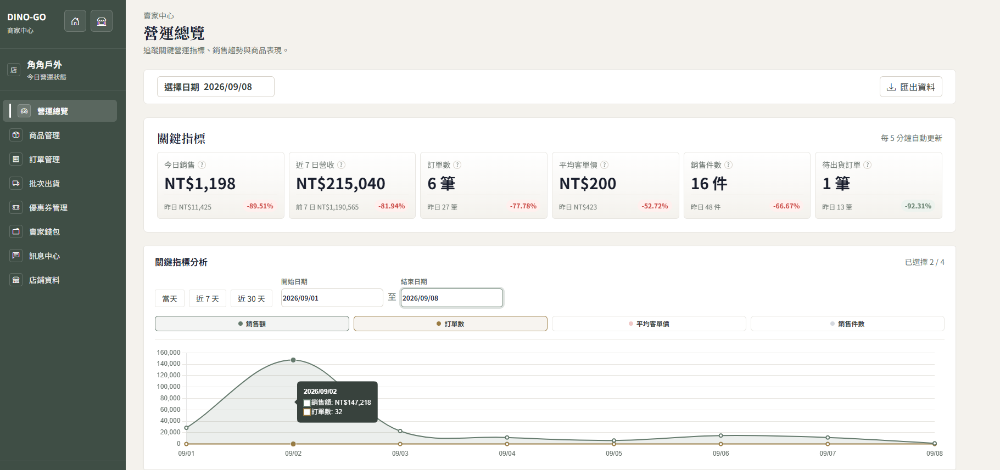
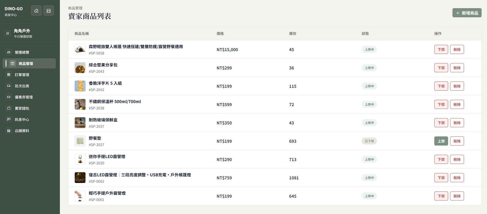
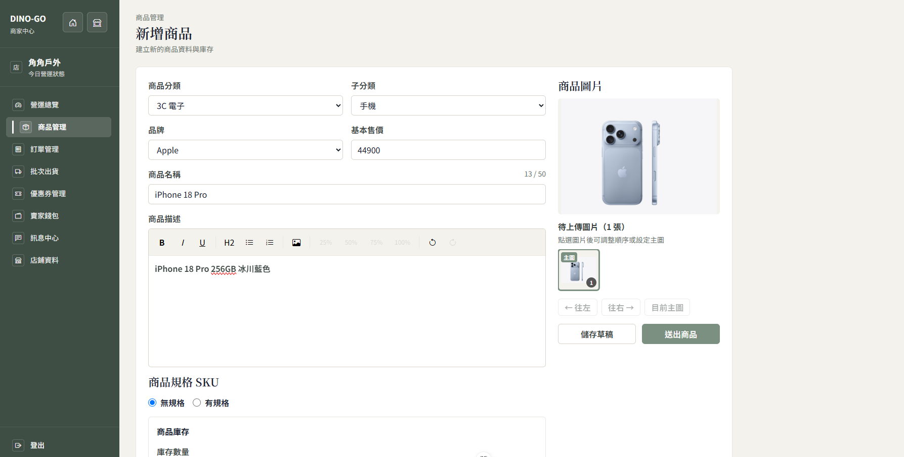
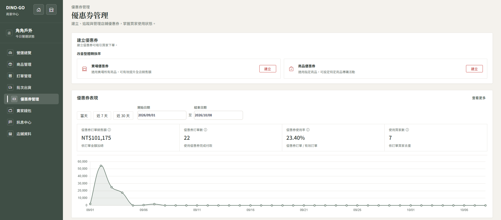
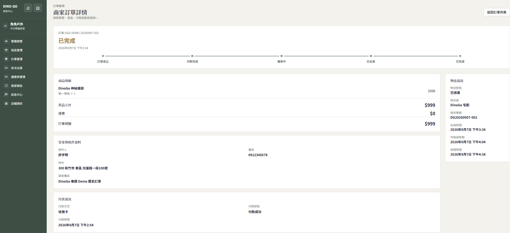
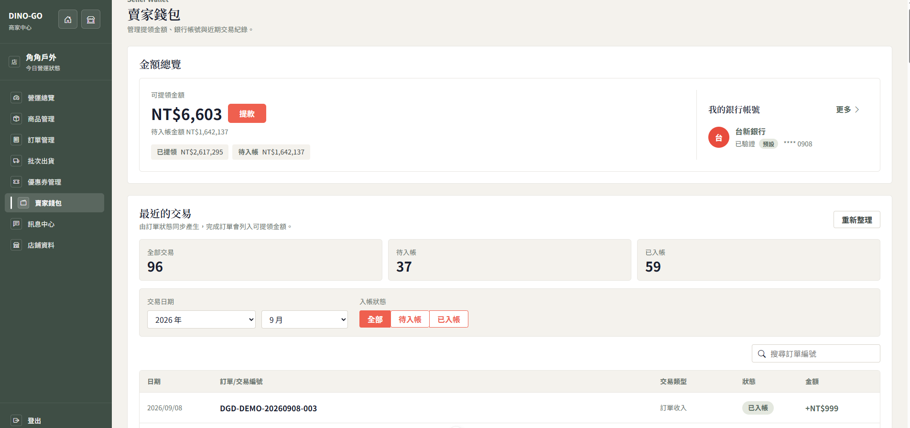

# DinoGo B2B2C 電商平台

DinoGo 是資展國際 Java 軟體工程師養成班的五人團隊專題，
提供會員購物、商品管理、訂單、付款、優惠券、商家中心及管理後台等功能。

> 本倉庫用於個人作品展示。我主要負責 Seller Center 賣家中心模組；
> 其他功能由團隊成員共同完成。

## 專案資訊

- 開發期間：2026/07～2026/09
- 團隊人數：5 人
- 專案類型：B2B2C 電商平台
- 我的角色：Seller Center 前後端功能開發

## 技術棧

### Backend

- Java 21
- Spring Boot
- Spring MVC
- Spring Data JPA / Hibernate
- Spring Security / JWT
- SQL Server
- Maven

### Frontend

- Vue 3
- Pinia
- Axios
- Chart.js
- Vite

### Development

- Git / GitHub
- Docker
- Postman

## 我的負責範圍

- 賣家商品查詢、新增、修改及上下架
- Seller 與 Product 的商品歸屬判斷
- 優惠券新增、查詢、修改及刪除
- 商家品牌資料與 Logo 上傳
- 商家營運 Dashboard 與銷售分析
- 商家錢包及提款功能
- 訂單列表、訂單詳情與出貨功能串接
- 前後端 API 整合與問題排查

## 代表性技術問題

### 避免賣家操作其他賣家的商品

早期功能曾使用前端傳入的 sellerId 判斷資料範圍，
可能造成不同賣家操作相同資料。

後續調整為：

1. 從 JWT 取得登入者身分。
2. 由登入會員取得對應 Seller。
3. 透過 Seller 與 Product 關聯確認商品歸屬。
4. 非商品擁有者不能查詢或修改該商品。

## 系統畫面

> 以下畫面均使用專題測試資料，不包含實際交易或正式使用者資料。

### 賣家營運總覽

Dashboard 彙整今日銷售、近七日營收、訂單數、平均客單價、銷售件數及待出貨訂單，並提供日期篩選、指標比較與資料匯出功能。

### 商品管理

賣家可以查看所屬商品的價格、庫存及上下架狀態，並執行新增、上下架及刪除操作。後端會依 JWT 登入身分取得 Seller，再確認商品是否屬於該賣家。

### 商品新增

商品表單包含分類、品牌、售價、名稱、商品描述、圖片及庫存等資料，並提供草稿及送出商品功能。

### 優惠券與成效分析

賣家可以建立賣場或指定商品優惠券，並追蹤優惠券訂單銷售額、訂單數、使用率及使用買家數。

### 訂單與物流狀態

訂單詳情呈現訂單成立、付款、備貨、出貨及完成等狀態，並整合物流商、物流單號及配送時間。

### 賣家錢包

賣家錢包彙整可提領、待入帳及已提領金額，並提供交易狀態篩選與提款功能。

## 系統架構

架構圖將補充至 `docs/architecture`。

## 團隊聲明

本作品為五人團隊共同開發。本倉庫僅供個人求職作品展示，
並區分個人負責功能與團隊共同完成內容。